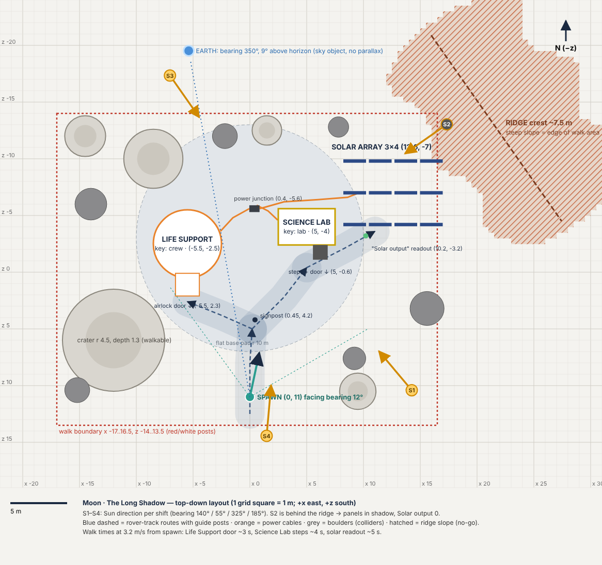

# Moon · The Long Shadow — карта, інтеграція, перевірки

Нотатки для команди українською. Усі видимі в грі написи — англійською.



## Що в модулі

| Файл | Що робить |
| --- | --- |
| `src/scenes/moon/layout.js` | **Єдине джерело координат**: спавн, модулі, масив, гребінь, кратери, валуни, маршрути, Земля, Сонце по ходах |
| `src/scenes/moon/terrain.js` | Рельєф із seed 1969: `heightAt(x, z)`, гребінь, кратери, дальній обрій; полярний меш (ближня частина відкидає тіні, дальня — ні) |
| `src/scenes/moon/base.js` | Life Support (`crew`), Science Lab (`lab`), сонячний масив 3×4, табло «Solar output», кабелі, вказівник, посадковий модуль, кільце + мітка **Selected** |
| `src/scenes/moon/props.js` | 4 типи каміння (instancing), валуни-колайдери, сліди ровера, сліди черевиків, стовпчики маршруту, маркери периметра |
| `src/scenes/moon/sky.js` | Чорне небо, стримане зоряне поле, процедурна Земля з атмосферним краєм, диск Сонця. Група рухається за камерою → нульовий паралакс |
| `src/scenes/moon/textures.js` | Канвас-текстури: таблички з піктограмами, табло, комірки панелей, Земля, мітка Selected |
| `src/scenes/moon/noise.js` | Simplex-шум із seed |
| `src/scenes/moon/index.js` | `createMoonEnvironment()` — збирає все, світло, тіні, зіткнення, стани ходів, клік |
| `src/scenes/placeholder.js` | Заглушка для Mars/Earth з тим самим інтерфейсом |
| `src/scene.js`, `src/main.js`, `src/missions.js`, `src/simulation.js` | **Тестовий стенд**, не продакшн-логіка. Відтворює API з брифу, щоб карту можна було пройти. Правила й баланс — у Codex |
| `scripts/check_moon.py` | Headless-проходження в Chrome + кадри |
| `scripts/sun_check.mjs` | Промінь від кожної панелі до Сонця: перевіряє, що освітлення збігається з `[7, 0, 7, 7]` |
| `scripts/topdown_svg.mjs` | Генерує цю схему з `layout.js` |

Зовнішніх асетів немає: усі моделі, текстури й Земля процедурні, запитів у мережу немає.

## Інтерфейс оточення

```js
import { createMoonEnvironment } from './scenes/moon/index.js';
const env = createMoonEnvironment();        // кешується: повторний виклик повертає той самий об’єкт
scene.add(env.root); scene.add(env.sky.group);
scene.background = env.background;

env.spawn                 // { x, z, yaw, pitch } — yaw 0 = північ (−z)
env.heightAt(x, z)        // висота ґрунту; камера = heightAt + env.eyeHeight (1.6)
env.resolveMove(x0, z0, x1, z1) // → {x, z} із ковзанням уздовж перешкод і межі
env.pick(camera, ndcX, ndcY)    // → 'crew' | 'lab' | null (рельєф перед модулем блокує клік)
env.setShift(i, { solarOutput }) // i = 0..3; світло, тінь гребеня, поворот панелей, табло
env.setSelected(['crew'])       // кільце на ґрунті + мітка «✓ Selected» + колір лампи
env.setHovered('lab' | null)    // підсвічує табличку модуля
env.update(dt, camera)          // кожен кадр: небо за камерою, анімація міток
env.dispose()                   // геометрії, матеріали, текстури, shadow map
```

Рухайте гравця підкроками ≤ 0,15 м (див. `src/scene.js`), щоб повільний кадр не «перестрибнув» колайдер.

## Підключення до коду Codex

1. Скопіювати `src/scenes/moon/` без змін.
2. У спільному `src/scene.js` у `mountScene(container, mission, shift, selected, onSelect, pose)`:
   - для `mission.id === 'moon'` створити оточення через `createMoonEnvironment()` замість нинішньої плити й блоків;
   - висоту камери брати з `env.heightAt`, рух — через `env.resolveMove`, клік — через `env.pick`;
   - при кожному виклику викликати `env.setShift(shift, { solarOutput: mission.generation[shift] })` і `env.setSelected(selected)`.
3. **Не перебудовувати сцену на кожен клік.** Стенд тримає сцену на `container.__stage` і лише оновлює стан. Якщо у Codex `mountScene` щоразу створює новий renderer, оточення все одно кешується, але renderer і шейдери компілюються заново. Краще перейти на оновлення.
4. `pose` мутується на місці, тож позиція й погляд зберігаються між ходами й після кліку. Якщо `pose` порожній — береться `env.spawn`.
5. Можливі перетини зі спільним `src/scene.js`: тип тіней (`PCFShadowMap`), tone mapping (`ACESFilmic`), FOV (65–80° залежно від ширини), обробники клавіш на `window`. Ці налаштування можна взяти з `src/scene.js` стенду.

## Освітлення по ходах

| Хід | Сонце (азимут / висота) | Генерація | Що видно |
| --- | --- | --- | --- |
| 1 | 140° / 7° | 7 | Панелі освітлені, табло зелене «7 · In sunlight» |
| 2 | 55° / 4° | **0** | Сонце за гребенем, тінь накриває масив і північ бази; табло червоне «0 · In shadow»; земне світло лишає модулі читабельними |
| 3 | 325° / 7,5° | 7 | Світло повернулося з північного заходу |
| 4 | 185° / 8° | 7 | Світло з півдня, база освітлена спереду |

`node scripts/sun_check.mjs` (промені з 60 точок на панелях): хід 1 — 60/60, хід 2 — **0/60**, хід 3 — 58/60 (2 точки — тінь антени лабораторії), хід 4 — 60/60.

## Наукові референси та спрощення

- Референс низького Сонця й довгих тіней: [NASA Science — Shadows near the Moon’s South Pole](https://science.nasa.gov/resource/shadows-near-the-moons-south-pole/) і [NASA SVS 4893](https://svs.gsfc.nasa.gov/4893). Біля полюсів Сонце не піднімається вище ~1,5°, тіні довгі й рухаються за азимутом.
- **Спрощення:** у грі висота Сонця 4–8°, щоб ґрунт і маршрут читалися з рівня очей; доба стиснута до 4 ходів, азимут рухається в один бік (140° → 55° → 325° → 185°).
- **Земля:** азимут 350°, 9° над обрієм, видно зі спавну. Видимість Землі — властивість вигаданої ділянки. Кутовий розмір ≈ 4,4° — художнє збільшення приблизно в 2,3 раза (реальний ≈ 1,9°), щоб її було видно на ноутбуці. Фаза Землі зафіксована й не змінюється між ходами.
- **Земне світло** (earthshine) реальне, але слабке; на ході 2 його підсилено для читабельності.
- База, гребінь, кратери й назви — вигадані.

## Що реально перевірено

Середовище: Linux-контейнер, `npm run build` (Vite 5, three 0.187), headless Google Chrome із програмним WebGL (SwiftShader). **На ноутбуці з GPU не перевірялося.**

`python3 scripts/check_moon.py` — 14/14:
- спавн (0, 11); W рухає вперед; висота очей над ґрунтом 1,60 м;
- крізь шлюз Life Support, лабораторію й гребінь пройти не можна;
- клік по табличці Life Support у 3D вибирає `crew`; позиція не змінюється після кліку й після Run Shift;
- на ході 2 в UI «Solar output: 0»;
- LS, LS, LS + Lab, LS + Lab завершує місію; кнопка веде на Mars;
- помилок у консолі немає.

Продуктивність: 281 draw call і ~127 тис. трикутників на кадр **разом із тіньовим проходом**. Програмний рендер дає ~2,5 FPS, тож про швидкість на справжньому GPU це нічого не каже. Якщо на слабкому ноутбуці буде менше 45 FPS, стенд сам знижує pixelRatio до 1. Наступний крок — об’єднати дрібні меші бази (`BufferGeometryUtils.mergeGeometries`) і зменшити shadow map до 1024.

## Ручна перевірка на ноутбуці (5 хв)

1. `npm install && npm run dev`, відкрити адресу з консолі.
2. Зі спавну: видно Землю ліворуч угорі, обидва модулі, вказівник, панелі й гребінь праворуч.
3. Дійти до шлюзу Life Support і до сходів лабораторії; упертися в стіни — камера не проходить і не провалюється.
4. Клікнути табличку модуля: з’являються кільце й «✓ Selected», кнопка під сценою стає Selected.
5. Run Shift → на ході 2 тінь гребеня накриває панелі, табло «0 · In shadow». Ходи 3–4 — знову 7.
6. Звузити вікно до ~480 px: сцена 4:3, кнопки під нею.
7. DevTools → Performance: FPS ≥ 45.
